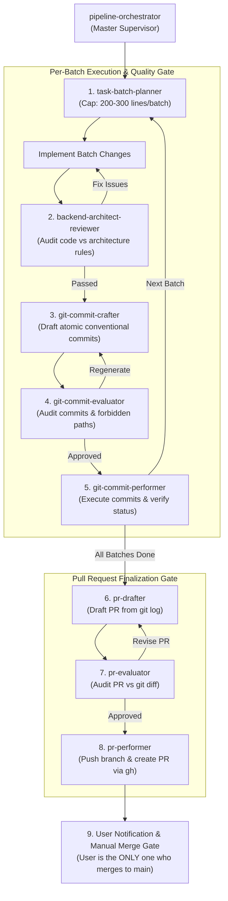

# MentorQ Agents Directory

This directory contains specialized AI agents designed to automate, orchestrate, and enforce quality throughout the MentorQ development lifecycle.

```
.agents/
├── pipeline-state.md                  # Active runtime state ledger (SSOT & crash-recovery, uncommitted)
│
└── agents/
    ├── orchestrator/
    │   └── pipeline-orchestrator.md   # Master orchestrator governing the entire multi-agent lifecycle
    │
    ├── planning/
    │   └── task-batch-planner.md      # Decomposes tasks into <= 200-300 line verifiable batches
    │
    ├── architecture/
    │   └── backend-architect-reviewer.md # Reviews NestJS code against architectural guidelines
    │
    ├── git/
    │   ├── git-commit-crafter.md      # Drafts atomic Conventional Commits for PowerShell
    │   ├── git-commit-evaluator.md    # Evaluates & audits proposed commits before execution
    │   └── git-commit-performer.md    # Safely executes finalized commits & verifies git status
    │
    └── pr/
        ├── pr-drafter.md              # Drafts PR title, description, and push commands from git log
        ├── pr-evaluator.md            # Evaluates PR description vs git diff & architectural rules
        └── pr-performer.md            # Pushes branch & creates PR using GitHub CLI (gh)
```

---

## Complete End-to-End Orchestrated Pipeline



---

## Agent Categories & Detailed Roles

### 0. Orchestration (`orchestrator/`)
- **[`pipeline-orchestrator`](file:///c:/Users/altha/OneDrive/Documents/MentorQ/.agents/agents/orchestrator/pipeline-orchestrator.md)**: Coordinates the entire workflow. Ensures each batch passes architecture review before commit drafting, passes commit evaluation before execution, and passes PR evaluation before PR creation. Enforces the strict rule that **only the human user merges PRs to main**.

### 1. Planning (`planning/`)
- **[`task-batch-planner`](file:///c:/Users/altha/OneDrive/Documents/MentorQ/.agents/agents/planning/task-batch-planner.md)**: Breaks down large feature implementations and refactoring phases into focused, self-contained batches capped at 200–300 lines of code changes.

### 2. Architecture & Quality (`architecture/`)
- **[`backend-architect-reviewer`](file:///c:/Users/altha/OneDrive/Documents/MentorQ/.agents/agents/architecture/backend-architect-reviewer.md)**: Reviews backend NestJS code against Controller -> Service -> Repository 3-layer architecture, zero Mongoose document leakage, and EDA rules.

### 3. Git Commit Lifecycle (`git/`)
- **[`git-commit-crafter`](file:///c:/Users/altha/OneDrive/Documents/MentorQ/.agents/agents/git/git-commit-crafter.md)**: Drafts atomic Conventional Commits per architectural layer (no bulk commits, shields `docs/` and `.agents/`).
- **[`git-commit-evaluator`](file:///c:/Users/altha/OneDrive/Documents/MentorQ/.agents/agents/git/git-commit-evaluator.md)**: Audits proposed commits for Conventional Commits syntax, forbidden files (`docs/**`, `.agents/**`), and PowerShell compatibility.
- **[`git-commit-performer`](file:///c:/Users/altha/OneDrive/Documents/MentorQ/.agents/agents/git/git-commit-performer.md)**: Executes approved commits and verifies repository clean working tree status.

### 4. Pull Request Lifecycle (`pr/`)
- **[`pr-drafter`](file:///c:/Users/altha/OneDrive/Documents/MentorQ/.agents/agents/pr/pr-drafter.md)**: Uses committed git log (`origin/main..HEAD`) as the single source of truth to draft a professional PR title and description.
- **[`pr-evaluator`](file:///c:/Users/altha/OneDrive/Documents/MentorQ/.agents/agents/pr/pr-evaluator.md)**: Cross-checks the PR description against `git diff`, ensures zero forbidden files are committed, and verifies build status.
- **[`pr-performer`](file:///c:/Users/altha/OneDrive/Documents/MentorQ/.agents/agents/pr/pr-performer.md)**: Pushes the branch to origin and submits the PR via GitHub CLI (`gh`).

---

## State Persistence & Anti-Hallucination Mechanism

Multi-agent pipelines can suffer from context drift or lost memory during long executions or environment restarts. MentorQ solves this via the **Persistent State Ledger** (`.agents/pipeline-state.md`):

1. **Single Source of Truth (SSOT):** `task-batch-planner` writes the initial batch plan to `.agents/pipeline-state.md`.
2. **Real-Time Step Updates:** As batches move through implementation, architecture review, and git commits, `pipeline-orchestrator` updates status badges (`⏳ PENDING` -> `🔄 IN_PROGRESS` -> `✅ DONE`), logs reviewer feedback, and notes commit SHAs directly on disk.
3. **Crash & Restart Resilience:** If a session resets or is paused, re-invoking `pipeline-orchestrator` immediately resumes from the earliest incomplete batch rather than starting over.
4. **Git Isolation:** `.agents/pipeline-state.md` acts as an ephemeral execution scratchpad and is strictly blocked from being staged into git commits by `git-commit-evaluator`.
